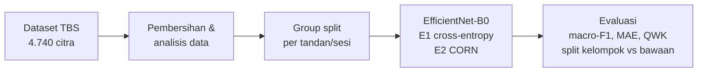

# Klasifikasi Kematangan TBS Kelapa Sawit dengan EfficientNet-B0 dan Regresi Ordinal

Repositori riset untuk mengklasifikasikan **lima tingkat kematangan tandan buah segar (TBS) kelapa sawit** dari citra RGB, menggunakan **EfficientNet-B0** dengan **regresi ordinal (CORN)**, dan dievaluasi pada **split berbasis kelompok foto per tandan/sesi** agar bebas kebocoran data.

## Ringkasan

- **Data:** 4.728 citra 256 × 256 dalam 5 kelas berurutan: Immature → PartiallyRipe → FullyRipe → OverRipe → Decayed.
- **Masalah utama yang ditemukan:** 47% citra berada dalam kelompok foto yang tersebar lintas train/val/test pada split bawaan dataset.
- **Pendekatan:** EfficientNet-B0 pretrained ImageNet, membandingkan kepala **cross-entropy** (E1) dan **CORN ordinal** (E2).
- **Metrik utama:** macro-F1 dan MAE (satuan kelas), ditambah QWK dan % kesalahan ≥ 2 tingkat.

## Struktur repositori

```
.
├── README.md
└── UTS/
    ├── README.md
    ├── Dataset riset/
    │   └── dataset.md
    ├── Metric evaluasi/
    │   └── metrik.md
    ├── Proposal Penelitian/
    │   └── proposal.md
    ├── Research Gap/
    │   └── gap.md
    └── Research Mindmap/
        ├── Mindmap Kematangan TBS Sawit.png
        └── mindmap.md
```

Mulai dari [`UTS/README.md`]a(UTS/README.md)

## Alur penelitian



## Lingkungan

- Google Colab (GPU T4 untuk training, CPU untuk analisis data)
- Python, PyTorch, torchvision, scikit-learn, imagehash, cleanlab, OpenCV

Dataset dan berkas hasil analisis tidak disimpan di repositori ini karena ukurannya.

## Penulis
Paulenta Silvania Silitonga (230810100208)
