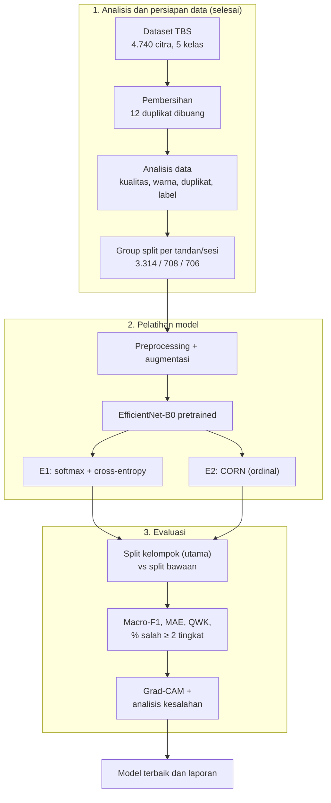

# Proposal Penelitian

## Klasifikasi Tingkat Kematangan Tandan Buah Segar Kelapa Sawit Menggunakan EfficientNet-B0 dengan Pendekatan Regresi Ordinal dan Evaluasi Berbasis Kelompok Data

Penelitian ini mengklasifikasikan lima tingkat kematangan TBS kelapa sawit dengan **EfficientNet-B0** dan **regresi ordinal CORN**, lalu mengevaluasinya pada **split berbasis kelompok foto per tandan/sesi**. Analisis awal menemukan bahwa 47% citra pada dataset publik yang dipakai berada dalam kelompok yang bocor di split bawaannya.

---

## 1. Latar belakang

Kualitas dan rendemen minyak sawit sangat dipengaruhi tingkat kematangan TBS saat dipanen. Penilaian kematangan di lapangan masih dilakukan secara visual oleh pekerja, sehingga subjektif dan tidak konsisten. Klasifikasi citra berbasis deep learning menjadi alternatif yang banyak diteliti, dan EfficientNet-B0 dilaporkan sebagai CNN ringan paling akurat untuk kematangan TBS (Suharjito dkk., 2021).

Namun ada tiga masalah pada penelitian sejenis. Pertama, tingkat kematangan bersifat **berurutan** (Immature → PartiallyRipe → FullyRipe → OverRipe → Decayed), tetapi umumnya diperlakukan sebagai kelas nominal, sehingga salah satu tingkat dan salah empat tingkat dihukum sama. Kedua, dataset kematangan sering berisi **beberapa foto dari tandan yang sama**; bila dibagi acak per gambar, foto kembar tersebar ke data latih dan uji sehingga akurasi terlalu optimis (Yagis dkk., 2021; Laroca dkk., 2023). Ketiga, evaluasi umumnya hanya melaporkan akurasi.

Analisis data awal pada dataset 4.728 citra menunjukkan ketiga masalah itu nyata: 2.230 citra (47%) berada dalam kelompok foto yang tersebar lintas split, warna saja hanya mencapai macro-F1 0,489, dan 79% kesalahan model awal hanya meleset satu tingkat. Rincian ada di [`Research Gap/gap.md`](../Research%20Gap/gap.md).

## 2. Rumusan masalah

1. Bagaimana karakteristik dataset kematangan TBS, khususnya kebocoran data antar split?
2. Bagaimana performa EfficientNet-B0 dengan regresi ordinal (CORN) dibandingkan klasifikasi biasa (cross-entropy)?
3. Seberapa besar perbedaan performa model antara split bawaan dan split berbasis kelompok?

## 3. Tujuan

1. Menganalisis karakteristik dan permasalahan dataset, serta membangun split berbasis kelompok yang bebas kebocoran.
2. Membandingkan EfficientNet-B0 + CORN dengan EfficientNet-B0 + cross-entropy pada macro-F1, MAE, QWK, dan proporsi kesalahan ≥ 2 tingkat.
3. Mengukur selisih performa antara split bawaan dan split berbasis kelompok.

## 4. Batasan masalah

- Backbone hanya EfficientNet-B0 pretrained ImageNet; tidak membandingkan arsitektur lain.
- Dataset publik 5 kelas, 4.728 citra 256 × 256; tidak menambah data lapangan.
- Label dipakai sebagaimana dari pembuat dataset, tanpa koreksi ahli.
- Klasifikasi satu tandan per citra, bukan deteksi objek.
- Tidak membangun aplikasi atau sistem deployment.

## 5. Manfaat

- **Akademis:** bukti kuantitatif dampak kebocoran data pada dataset kematangan TBS dan penerapan regresi ordinal pada masalah ini.
- **Praktis:** model yang kesalahannya cenderung "dekat" (meleset satu tingkat) lebih aman untuk mendukung keputusan panen dan grading.
- **Dataset:** dokumentasi karakteristik dan split berbasis kelompok yang dapat dipakai ulang oleh penelitian lain.

## 6. Metodologi

### 6.1 Alur penelitian

### 6.2 Data

Dataset dan hasil analisisnya dijelaskan di [`Dataset Riset/dataset.md`](../Dataset%20Riset/dataset.md). Split utama adalah **split berbasis kelompok** (`split_grup`): satu kelompok foto tandan/sesi masuk ke satu split saja, proporsi 70/15/15 dijaga per kelas, dan tidak ada kelompok yang bocor.

### 6.3 Preprocessing dan augmentasi

| Tahap | Operasi | Parameter | Dasar | Rujukan |
| --- | --- | --- | --- | --- |
| Semua split | Resize | 224 × 224 | Input EfficientNet-B0; data asli 256 × 256 | Suharjito dkk. (2021); Anhar dkk. (2026) |
| Semua split | Normalisasi | mean/std ImageNet | Sesuai bobot pretrained | Suharjito dkk. (2021) |
| Latih | Flip horizontal & vertikal | p = 0,5 | Orientasi tandan bebas | Xu dkk. (2023) |
| Latih | Rotasi | 0–360° | Banyak foto diambil dengan HP diputar | Xu dkk. (2023) |
| Latih | Random resized crop | skala 0,8–1,0 | Framing bervariasi; kurangi ketergantungan latar | Suharjito dkk. (2021); Xiao dkk. (2021) |
| Latih | ColorJitter brightness / contrast | 0,15 / 0,15 | Variasi kecerahan alami dalam kelas (CV = 0,149) | Xu dkk. (2023) |
| Latih | ColorJitter saturation | 0,05 | Saturasi ikut membedakan kelas | Xu dkk. (2023); Zulkhoiri dkk. (2024) |
| Latih | ColorJitter hue | **0** | Selisih hue PartiallyRipe → FullyRipe hanya 2,1° | Xu dkk. (2023); Ng dkk. (2026) |
| Latih | Gaussian/motion blur | p ≈ 0,2 | Motion blur nyata pada ±1% citra | Yoshihara dkk. (2023); Huang dkk. (2025) |

### 6.4 Model

- **Backbone:** EfficientNet-B0 pretrained ImageNet (±5,3 juta parameter), dipilih karena ringan, cocok untuk input 224 × 224, terbukti pada kematangan TBS, dan relatif tahan blur (Suharjito dkk., 2021; Sandotra dkk., 2023). Linear probe fitur pretrained-nya sudah mencapai macro-F1 0,811, dibanding 0,489 dari fitur warna.
- **E1 (baseline):** kepala softmax 5 kelas + cross-entropy.
- **E2 (utama):** kepala **CORN**, yaitu K − 1 = 4 tugas biner bersyarat "apakah kelas > k, bila kelas > k − 1?", sehingga prediksi dijamin konsisten urutan (Shi dkk., 2023).
- **Training:** transfer learning dua fase (kepala dulu dengan backbone dibekukan, lalu fine-tuning seluruh jaringan) (Suharjito dkk., 2021; Anhar dkk., 2026); optimizer AdamW (Zhou dkk., 2024); early stopping berdasarkan macro-F1 validasi (Saputra, 2026); hyperparameter identik untuk E1 dan E2.

### 6.5 Skenario eksperimen

| Kode | Kepala / loss | Split | Seed | Run |
| --- | --- | --- | ---: | ---: |
| E1 | Softmax + cross-entropy | Kelompok | 3 | 3 |
| E2 | CORN | Kelompok | 3 | 3 |
| E1-B | Softmax + cross-entropy | Bawaan | 1 | 1 |
| E2-B | CORN | Bawaan | 1 | 1 |
| **Total** | | | | **8** |

Perkiraan beban: ±10–20 menit per run di GPU T4 (Google Colab), total ±2–3 jam GPU.

### 6.6 Evaluasi

Metrik dan protokol lengkap ada di [`Metrik Evaluasi/metrik.md`](../Metrik%20Evaluasi/metrik.md). Ringkasnya: macro-F1 dan MAE sebagai metrik utama, ditambah QWK, % salah ≥ 2 tingkat, confusion matrix, rata-rata ± standar deviasi 3 seed (Bouthillier dkk., 2021), dan Grad-CAM (Zaki dkk., 2023).

## 7. Hipotesis dan hasil yang diharapkan

| Rumusan masalah | Hipotesis | Bila tidak terbukti |
| --- | --- | --- |
| 2. CORN vs cross-entropy | CORN menghasilkan **MAE lebih kecil** dan **kesalahan ≥ 2 tingkat lebih sedikit**; akurasi bisa setara | Dianalisis apakah cross-entropy sudah jarang membuat kesalahan jauh (linear probe: 79% kesalahan hanya 1 tingkat) |
| 3. Split bawaan vs kelompok | Performa di split bawaan **lebih tinggi** dari split kelompok | Selisih kecil berarti kebocoran tidak memengaruhi model pada dataset ini, juga temuan yang sah |

Keunggulan regresi ordinal yang diharapkan ada pada **jenis kesalahan**, bukan akurasi. Akurasi pada split kelompok kemungkinan lebih rendah dari angka di penelitian lain, karena model diuji pada tandan/sesi yang belum pernah dilihatnya.

## 8. Keterbatasan

- Pengelompokan foto memakai heuristik (kemiripan visual + nomor file), bukan ID tandan, sehingga kebocoran terukur adalah batas bawah.
- Label tidak diverifikasi ahli; 740 kandidat label meragukan dicatat, tidak dikoreksi.
- Kelas Decayed diasumsikan sebagai tahap setelah OverRipe.
- Bias latar antar kelas dikurangi dengan augmentasi, tetapi tidak dihilangkan.

## Daftar pustaka

- Anhar, A., Wajidi, F., & Insani, C. N. (2026). Two-stage transfer learning with EfficientNetB0 for four-class banana ripeness classification. *Edumatic: Jurnal Pendidikan Informatika*, 10(2). https://doi.org/10.29408/edumatic.v10i2.34588
- Bouthillier, X., dkk. (2021). Accounting for variance in machine learning benchmarks. *MLSys*.
- Huang, Y., dkk. (2025). Lightweight GAN for restoring blurred images to enhance citrus detection. *Plants*, 14(19), 3085. https://doi.org/10.3390/plants14193085
- Laroca, R., dkk. (2023). Do we train on test data? The impact of near-duplicates on license plate recognition. *IJCNN 2023*.
- Ng, K.-H., dkk. (2026). Physics-informed neural network-assisted imaging for oil palm fruit ripeness classification. *Electronics*, 15(3), 671. https://doi.org/10.3390/electronics15030671
- Sandotra, N., dkk. (2023). Analyzing performance of deep learning models under the presence of distortions in identifying plant leaf disease. *IJ-ICT*, 12(2), 115–126. https://doi.org/10.11591/ijict.v12i2.pp115-126
- Saputra, M. A. (2026). Class imbalance in deep learning-based image classification: A systematic review. *JAIC*, 10(5).
- Shi, X., Cao, W., & Raschka, S. (2023). Deep neural networks for rank-consistent ordinal regression based on conditional probabilities. *Pattern Analysis and Applications*.
- Suharjito, Elwirehardja, G. N., & Prayoga, J. S. (2021). Oil palm fresh fruit bunch ripeness classification on mobile devices using deep learning approaches. *Computers and Electronics in Agriculture*, 188, 106359. https://doi.org/10.1016/j.compag.2021.106359
- Xiao, K., Engstrom, L., Ilyas, A., & Madry, A. (2021). Noise or signal: The role of image backgrounds in object recognition. *ICLR*.
- Xu, M., Yoon, S., Fuentes, A., & Park, D. S. (2023). A comprehensive survey of image augmentation techniques for deep learning. *Pattern Recognition*, 137, 109347. https://doi.org/10.1016/j.patcog.2023.109347
- Yagis, E., dkk. (2021). Effect of data leakage in brain MRI classification using 2D convolutional neural networks. *Scientific Reports*, 11. https://doi.org/10.1038/s41598-021-01681-w
- Yoshihara, S., Fukiage, T., & Nishida, S. (2023). Does training with blurred images bring convolutional neural networks closer to humans? *Frontiers in Psychology*. https://doi.org/10.3389/fpsyg.2023.1047694
- Zaki, N., dkk. (2023). Transfer learning and explainable artificial intelligence enhance the classification of date fruit varieties. *IIT 2023*, IEEE. https://doi.org/10.1109/IIT59782.2023.10366495
- Zhou, P., Xie, X., Lin, Z., & Yan, S. (2024). Towards understanding convergence and generalization of AdamW. *IEEE TPAMI*, 46(9), 6486–6493. https://doi.org/10.1109/TPAMI.2024.3382294
- Zulkhoiri, M. A., dkk. (2024). Investigation of oil palm fruit bunch ripeness classification using machine learning classifiers. *E3S Web of Conferences*, 595, 02010. https://doi.org/10.1051/e3sconf/202459502010
