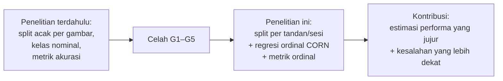

# Riset Gap: Klasifikasi Kematangan TBS Kelapa Sawit

Penelitian kematangan TBS berbasis citra umumnya melaporkan akurasi tinggi, tetapi jarang memeriksa **kebocoran data antar split**, hampir selalu memperlakukan kematangan sebagai **kelas nominal**, dan jarang mengevaluasi **jenis kesalahan** serta **dasar keputusan model**. Penelitian ini mengisi celah tersebut dengan split berbasis kelompok, regresi ordinal (CORN), dan metrik ordinal.

> Pemetaan di bawah disusun dari abstrak dan isi penelitian yang ditelusuri. Kolom "Catatan" menyatakan apa yang **tidak dilaporkan** di sumber tersebut, bukan klaim bahwa penulisnya tidak melakukannya.

---

## 1. Penelitian terdahulu

| Penelitian | Data | Metode | Hasil utama | Catatan terkait gap |
| --- | --- | --- | --- | --- |
| Suharjito dkk. (2021), *Comput. Electron. Agric.* 188 | Citra TBS | CNN ringan (EfficientNetB0, MobileNet) + transfer learning + augmentasi 9-angle crop | EfficientNetB0 terbaik, akurasi 0,89 | Kelas nominal; pemeriksaan duplikat antar split tidak dilaporkan |
| Rasmila dkk. (2025), *IJCCS* 19(4) | 4.578 citra, 6 kelas | YOLOv8s vs Faster R-CNN | Precision & recall > 99%, mAP@0.5:0.95 = 0,925 | Angka sangat tinggi; strategi split terhadap foto beruntun tidak dilaporkan |
| Suparto & Pribadi (2026), *Sisfokom* 15(2) | Dataset publik TBS, sangat tidak seimbang | YOLOv11-nano + class-balanced focal loss | mAP@0.5 = 0,783 | Menangani imbalance; kelas tetap nominal |
| Ng dkk. (2026), *Electronics* 15(3) | 112 citra, 3 kelas | Physics-informed neural network (rasio merah-hijau) | Akurasi 0,73 vs CNN 0,68 | Menegaskan warna sebagai sinyal fisik kematangan; data kecil |
| Zulkhoiri dkk. (2024), *E3S Web Conf.* 595 | Citra TBS, 3 kelas | Fitur warna HSV/RGB/YCbCr + KNN/SVM | Fitur warna mampu membedakan 3 kelas | Hanya fitur warna; kelas tengah tidak diuji |
| Kawer & Wahyuni (2026), *Jutisi* 15(3) | Pepaya, 500 → 246 citra unik | Deduplikasi SHA-256 + MobileNetV2 / EfficientNet-B0 | 50,8% data ternyata berulang | Contoh langka yang memeriksa duplikat sebelum split |
| Shi dkk. (2023), *Pattern Anal. Appl.* | Umum (bukan buah) | CORN: regresi ordinal berbasis probabilitas bersyarat | Prediksi konsisten urutan, MAE lebih rendah | Belum ditemukan penerapannya pada kematangan TBS |
| Yagis dkk. (2021), *Scientific Reports* 11 | MRI otak | Split per irisan vs per subjek | Split per irisan menaikkan akurasi 29–55% | Bukti umum bahwa split per gambar menghasilkan akurasi semu |

## 2. Celah penelitian

| Kode | Celah | Bukti dari dataset penelitian ini | Cara penelitian ini mengisinya |
| --- | --- | --- | --- |
| **G1** | **Evaluasi rentan bocor.** Split acak per gambar; deduplikasi dan near-duplicate jarang diperiksa | 3.010 citra (64%) punya kembaran; 2.230 citra (47%) berada dalam kelompok bocor di split bawaan | Split berbasis kelompok tandan/sesi; membandingkan hasil di split bawaan vs split kelompok |
| **G2** | **Kematangan diperlakukan nominal.** Urutan Immature → Decayed tidak dimanfaatkan | 79% kesalahan linear probe hanya meleset 1 tingkat; label meragukan terkonsentrasi di kelas bertetangga | Regresi ordinal CORN dibandingkan dengan cross-entropy |
| **G3** | **Evaluasi hanya akurasi.** Jenis kesalahan dan kelas minoritas jarang dilaporkan | Rasio kelas 3,6; tanpa CNN, Immature ↔ Decayed tertukar 11% | Macro-F1, MAE, QWK, % salah ≥ 2 tingkat |
| **G4** | **Dasar keputusan model jarang diperiksa** | Warna latar saja memberi macro-F1 0,374 (acak 0,20); FullyRipe di pohon ditebak Immature | Augmentasi pengurang ketergantungan latar + Grad-CAM |
| **G5** | **Kualitas data jarang dianalisis** (blur, label) | Motion blur ±1%; 740 kandidat label meragukan (15,7%) | Dianalisis dan dilaporkan sebagai karakteristik serta keterbatasan dataset |

## 3. Penelitian

**Kontribusi yang diharapkan**

1. Bukti kuantitatif kebocoran data pada dataset publik kematangan TBS (47% citra) dan besarnya selisih performa antara split bawaan dan split berbasis kelompok.
2. Perbandingan EfficientNet-B0 dengan regresi ordinal (CORN) dan klasifikasi biasa pada metrik ordinal.
3. Analisis karakteristik dataset yang terdokumentasi (warna, kualitas, label), yang dapat dipakai ulang oleh penelitian lain pada dataset yang sama.

## 4. Di luar cakupan

- Deteksi objek banyak tandan dalam satu gambar (YOLO, Faster R-CNN).
- Pembanding ordinal lain (CORAL), weighted sampler, label smoothing.
- Verifikasi label oleh ahli grading sawit.
- Pengujian lintas dataset dan data lapangan baru.

## Penelitian Terdahulu

- Kawer, W. H. J., & Wahyuni, I. (2026). *Jutisi*, 15(3), 1265–1280.
- Ng, K.-H., dkk. (2026). Physics-informed neural network-assisted imaging for oil palm fruit ripeness classification. *Electronics*, 15(3), 671. https://doi.org/10.3390/electronics15030671
- Rasmila, R., Oktavian, S. D., Dasmen, R. N., & Amalia, R. (2025). A comparative deep learning approach for classifying oil palm fruit ripeness levels using YOLOv8s and Faster R-CNN. *IJCCS*, 19(4). https://doi.org/10.22146/ijccs.111942
- Shi, X., Cao, W., & Raschka, S. (2023). Deep neural networks for rank-consistent ordinal regression based on conditional probabilities. *Pattern Analysis and Applications*.
- Suharjito, Elwirehardja, G. N., & Prayoga, J. S. (2021). Oil palm fresh fruit bunch ripeness classification on mobile devices using deep learning approaches. *Computers and Electronics in Agriculture*, 188, 106359. https://doi.org/10.1016/j.compag.2021.106359
- Suparto, A., & Pribadi, M. R. (2026). Improving oil palm fruit detection under class imbalance using class-balanced focal loss on YOLOv11. *Sisfokom*, 15(2), 165–176.
- Yagis, E., dkk. (2021). Effect of data leakage in brain MRI classification using 2D convolutional neural networks. *Scientific Reports*, 11. https://doi.org/10.1038/s41598-021-01681-w
- Zulkhoiri, M. A., dkk. (2024). Investigation of oil palm fruit bunch ripeness classification using machine learning classifiers. *E3S Web of Conferences*, 595, 02010. https://doi.org/10.1051/e3sconf/202459502010
