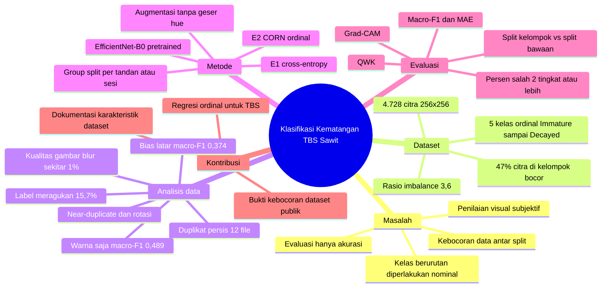

# Mind Map Riset: Klasifikasi Kematangan TBS Sawit

Peta ini merangkum penelitian dalam enam cabang: **masalah**, **dataset**, **analisis data**, **metode**, **evaluasi**, dan **kontribusi**. Versi gambar ada di [`Peta Riset Kematangan TBS Sawit.png`](Peta%20Riset%20Kematangan%20TBS%20Sawit.png).

## Versi Mermaid

GitHub menampilkan blok di bawah sebagai diagram secara otomatis.

## Keterkaitan antar cabang

| Masalah | Bukti dari analisis data | Jawaban di metode / evaluasi |
| --- | --- | --- |
| Kebocoran data antar split | 47% citra di kelompok bocor; 29 pasangan duplikat hasil rotasi/flip | Group split per tandan/sesi; bandingkan split kelompok vs split bawaan |
| Kelas berurutan diperlakukan nominal | 79% kesalahan model awal hanya meleset 1 tingkat; label meragukan di kelas bertetangga | E2 CORN ordinal; MAE, QWK, % salah ≥ 2 tingkat |
| Evaluasi hanya akurasi | Rasio imbalance 3,6 | Macro-F1 sebagai metrik utama |
| Model bisa memakai jalan pintas | Warna latar saja → macro-F1 0,374 | Augmentasi + Grad-CAM |
| Warna saja tidak cukup | Warna saja → macro-F1 0,489; fitur EfficientNet-B0 → 0,811 | EfficientNet-B0; hue tidak diaugmentasi |

Rincian setiap cabang: [dataset](../dataset%20riset/dataset.md) · [metrik](../metrik%20evaluasi/metrik.md) · [gap](../riset%20gap/gap.md) · [proposal](../proposal%20penelitian/proposal.md).
